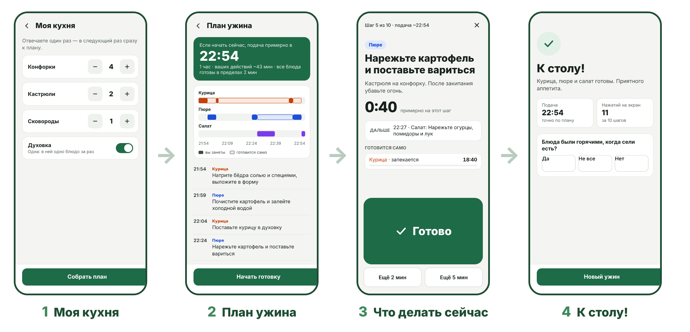

# Макеты и прототип «К столу»

## Октябрьские макеты

Четыре экрана из отчёта об исследовании показывают путь от настройки кухни до подачи ужина. Блюда и минуты в макете приведены для примера.

## Рабочий прототип

Скриншоты показывают локальную версию от 19–20 ноября 2026 года.

| Экран         | Мобильная версия                                                                              | Версия для компьютера                 |
| ------------- | --------------------------------------------------------------------------------------------- | ------------------------------------- |
| Выбор блюд    | [Скриншот](choose-dishes-mobile.png)                                                          | [Скриншот](choose-dishes-desktop.png) |
| Профиль кухни | [Настройки кухни](kitchen-profile.png)                                                        |                                       |
| Своё блюдо    | [Форма добавления](custom-dish-mobile.png)                                                    |                                       |
| План ужина    | [Скриншот](dinner-plan-mobile.png), [демонстрационный пример](dinner-plan-example-mobile.png) | [Скриншот](dinner-plan-desktop.png)   |
| Сейчас        | [Скриншот](cooking-now-mobile.png)                                                            | [Скриншот](cooking-now-desktop.png)   |
| Итог          | [Скриншот](dinner-complete-mobile.png)                                                        |                                       |

На КТ-2 показали гречку с маслом и жареные кабачки, продление таймера и восстановление готовки после перезагрузки. [Сценарий MVP](../kt2/mvp-scenario.pdf)
