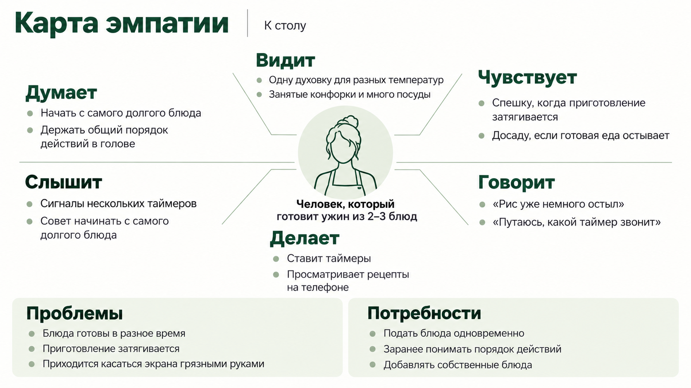
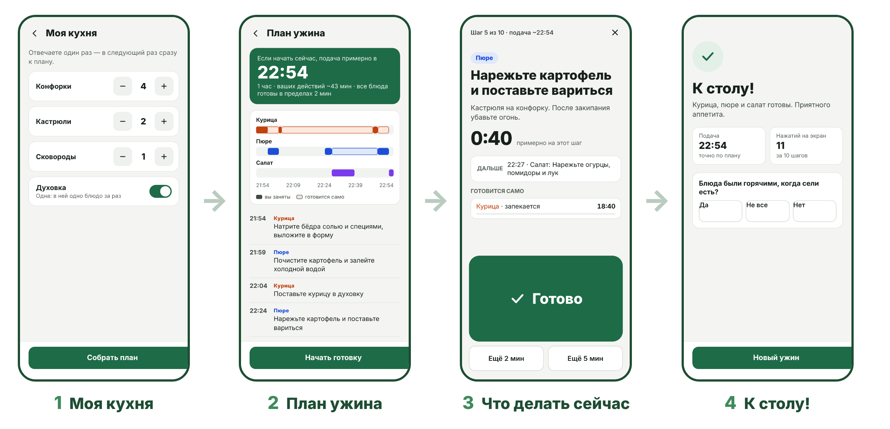

# Отчёт об исследовании «К столу»

Этапы дизайн-мышления и проектирование прототипа. Октябрь 2026 года.

Команда проекта — Андрей Кулев, Арсений Крюков и Максим Смирнов.

## Введение

Обычно рецепт описывает приготовление одного блюда. Когда на ужин нужны два-три блюда, человеку приходится самостоятельно согласовывать действия: что начать первым, когда освободится конфорка и что можно сделать, пока варится крупа. При неудачном распределении времени одно блюдо остывает, пока другое ещё готовится, а время ужина откладывается.

Цель проекта — разработать веб-приложение, которое объединяет приготовление 2–3 блюд в общий план с учётом доступного кухонного оборудования и пошагово помогает пользователю выполнить его, чтобы блюда были готовы примерно одновременно.

Исследовательский вопрос: что мешает одновременно подать ужин из 2–3 блюд и в каких ситуациях возникают такие трудности?

Исходная гипотеза: даже люди, умеющие готовить, могут испытывать трудности с согласованием действий при приготовлении нескольких блюд. Интервью дали предварительное подтверждение этой гипотезе и показали, что значение имеют также ограничения кухонного оборудования и необходимость следить за несколькими процессами одновременно.

Работа построена по шести этапам дизайн-мышления:

Эмпатия — интервью, кабинетное исследование, карта эмпатии.

Фокусировка — выводы, целевая аудитория, формулировка потребности пользователя (POV) и вопрос «Как мы могли бы…» (HMW).

Генерация идей — семь идей и обзор аналогов.

Выбор идеи — оценка по критериям.

Прототипирование — требования к минимально жизнеспособному продукту (MVP) и макеты интерфейса.

Тестирование — план предстоящей проверки прототипа.

## 1. Эмпатия

### 1.1. Интервью

Мы провели пять интервью по единому сценарию. Участников просили вспомнить последний реальный ужин из нескольких блюд: что готовили, в каком порядке, что пошло не так. Идею приложения показывали только в конце, чтобы не подсказывать ответы. Участники обозначены P1–P5.

Трое участников (P1, P4, P5) часто готовят ужин самостоятельно, двое (P2, P3) готовят редко. Все трое часто готовящих участников описали недавние трудности при приготовлении нескольких блюд. Это позволяет предположить, что проблема возникает и у людей с опытом.

| Участник | Частота приготовления | Описанная трудность              |
| -------- | --------------------- | -------------------------------- |
| P1       | 3–4 раза в неделю     | Рис остыл до готовности курицы   |
| P2       | Редко                 | Креветки пережарились            |
| P3       | Редко                 | Много посуды, не хватает времени |
| P4       | 3–4 раза в неделю     | Ужин задержался на 15 минут      |
| P5       | Почти ежедневно       | Ужин задержался почти на час     |

Участники интервью и описанные трудности

У четырёх из пяти участников блюда одного ужина были готовы в разное время. У всех пятерых приготовление заняло больше времени, чем им хотелось.

Наглядный пример описала участница P5. Она готовила форель, киноа и кексы. Для кексов требовалась температура 170 °C, для рыбы — 200 °C, а духовка была одна. Пока участница ждала, когда освободится духовка, киноа сварилась и остыла, а время ужина пришлось отложить.

Дословные цитаты из интервью:

«Рис уже немного остыл, когда была готова курица» — P1

«Путаюсь, какой таймер звонит — на картошку или на мясо» — P4

«Хотела бы заранее понимать, что процессы столкнутся лбами» — P5

### 1.2. Desk research

Пять интервью дают материал для предварительных выводов, но не позволяют оценить распространённость проблемы. Для дополнительного контекста мы обратились к опубликованным исследованиям организации приготовления нескольких блюд.

В исследовании Ipsos по заказу Samsung, опубликованном в 2011 году, 56% участников, готовивших праздничные блюда, назвали основной трудностью согласование времени приготовления всех блюд к общей подаче .

### 1.3. Карта эмпатии

На основе интервью мы составили карту эмпатии. В центре — человек, который готовит ужин из 2–3 блюд. Карта объединяет высказывания участников и наши интерпретации их опыта.

Основное противоречие: даже если человек начинает с блюда, которое готовится дольше всего, это не всегда помогает согласовать остальные действия. Проблемы и потребности, отражённые в карте эмпатии, стали основой следующего этапа.

## 2. Фокусировка

### 2.1. Выводы

Мы сгруппировали результаты интервью по темам и выделили четыре аспекта проблемы. Они связаны с распределением времени, использованием оборудования и переключением внимания между действиями.

Время. Правило «сначала готовить самое долгое блюдо» не учитывает, что можно сделать в паузах и когда освободится оборудование.

Оборудование. Если блюда требуют разной температуры запекания, их приготовление в одной духовке необходимо согласовывать заранее.

Внимание. Выполняя одно действие, человек может упустить момент, когда нужно проверить другое блюдо.

Таймеры. При нескольких одновременно работающих таймерах бывает трудно понять, к какому блюду относится сигнал.

### 2.2. Целевая аудитория

Первоначально мы ориентировались на начинающих кулинаров. Однако P4 и P5 готовят часто и уверенно и при этом сталкиваются с описанными трудностями. Поэтому основным признаком аудитории мы выбрали ситуацию приготовления, а не уровень опыта. Для первой версии ориентируемся на людей 20–30 лет, которые самостоятельно готовят ужин не менее трёх раз в неделю: 2–3 блюда на 1–2 человек на домашней кухне. По характеру приготовления к этой группе относятся P1, P4 и P5. Возрастные границы — рабочее ограничение первой версии, которое предстоит уточнить.

Участники, которые готовят редко (P2, P3), тоже знакомы с проблемой, но могут обращаться к приложению реже. Основной сценарий первой версии — ужин в будний день. Приготовление еды для гостей планируется рассмотреть на следующих этапах.

### 2.3. Потребность пользователя и вопрос HMW

Потребность пользователя (POV): человеку, который регулярно готовит ужин из 2–3 блюд, нужен общий порядок действий с учётом доступного оборудования, поскольку отдельные рецепты не помогают согласовать время приготовления всех блюд.

Вопрос HMW: как мы могли бы помочь пользователю подать все блюда горячими, не удерживая весь план в голове и реже прикасаясь к телефону во время готовки?

| Параметр     | Рабочее ограничение первой версии                                |
| ------------ | ---------------------------------------------------------------- |
| Сценарий     | Ужин в будний день                                               |
| Регулярность | Не менее трёх самостоятельных приготовлений ужина в неделю       |
| Объём        | 2–3 блюда на 1–2 человек                                         |
| Возраст      | 20–30 лет; границы предстоит уточнить                            |
| Оборудование | Домашняя кухня с доступным пользователю набором техники и посуды |

Рабочие границы целевой аудитории

## 3. Генерация идей

### 3.1. Семь идей

В ответ на вопрос HMW мы предложили семь вариантов решения. На этапе генерации идей их не оценивали: использовали выводы интервью и функции существующих приложений.

Общий автоплан — автоматическое построение последовательности действий для всех выбранных блюд с учётом оборудования кухни.

Обратное планирование от времени подачи — расчёт времени начала действий исходя из желаемого времени ужина.

Ручное упорядочивание шагов — пользователь сам задаёт последовательность, а приложение предупреждает о пересечениях в использовании оборудования.

Готовые наборы — сочетания блюд с заранее составленным порядком приготовления.

Таймеры для отдельных блюд — каждый таймер подписан, чтобы пользователь мог определить назначение сигнала.

Экран «Что делать сейчас» — один текущий шаг крупным шрифтом и кнопка «Готово».

Голосовое управление — переключение шагов голосом, когда руки заняты или испачканы. Эту идею предложила P5.

### 3.2. Анализ аналогов

В сравнении рассмотрены четыре прямых аналога — Fatto, Pinch, Convivium и CookSync — и косвенный аналог Food.ru. Сравнение основано на официальных описаниях и документации, а не на практическом тестировании. Сведения проверены 22 октября 2026 года. Отсутствие функции в описании не считаем доказательством её отсутствия в приложении.

| Решение   | План нескольких блюд  | Учёт оборудования                                    | Характер решения                                 |
| --------- | --------------------- | ---------------------------------------------------- | ------------------------------------------------ |
| Fatto     | Да, по шагам          | Да                                                   | Браузер и iOS; бесплатный тариф до двух рецептов |
| Pinch     | Да, время начала блюд | Выбор техники и режима; ограничения требуют проверки | iPhone; есть бесплатный режим                    |
| Convivium | Да, по шагам          | Да                                                   | Браузер; открытый код; примеры ужинов            |
| CookSync  | Да, по шагам          | Да, включая занятость повара                         | Android; локальное хранение; без подписки        |
| Food.ru   | В описании не заявлен | В описании не заявлен                                | Русскоязычный каталог рецептов                   |
| «К столу» | Планируется           | Планируется                                          | Русскоязычный веб-MVP                            |

Сравнение с аналогами по заявленным возможностям

Fatto предлагает общий план нескольких блюд, учёт оборудования и пересчёт времени при задержках. На сайте заявлен бесплатный тариф для двух рецептов на один приём пищи и тариф Pro за 12 долларов в месяц. Convivium учитывает занятость повара, конфорок и духовки. CookSync также заявляет учёт активных и пассивных шагов, оборудования и задержек. Следовательно, эти возможности сами по себе не являются уникальными преимуществами проекта.

Проект «К столу» ориентирован на русскоязычный сценарий буднего ужина из 2–3 блюд, небольшой каталог заранее подготовленных рецептов и простой экран текущего действия.

## 4. Выбор идеи

Каждую идею мы оценили по пяти критериям от 1 до 3 баллов: польза для пользователя, удобство у плиты, возможность реализации к 14 декабря 2026 года, доступность данных о рецептах и возможность проверки результата. Критерию пользы присвоили вес 2, поскольку он отражает потребности, выявленные в интервью. Максимально возможная оценка — 18 баллов. Итог рассчитывается как сумма удвоенной оценки пользы и оценок четырёх остальных критериев. Баллы отражают экспертную оценку команды.

Таблица 5 — Оценка идей по критериям

| Идея                         | Польза ×2 | Удобство | Срок | Данные | Проверка | Итог |
| ---------------------------- | --------- | -------- | ---- | ------ | -------- | ---- |
| 1. Общий автоплан            | 3         | 2        | 2    | 2      | 3        | 15   |
| 2. Обратное планирование     | 2         | 1        | 2    | 2      | 2        | 11   |
| 3. Порядок шагов вручную     | 1         | 2        | 3    | 3      | 2        | 12   |
| 4. Готовые наборы            | 2         | 3        | 3    | 1      | 2        | 13   |
| 5. Таймеры по блюдам         | 1         | 3        | 3    | 3      | 2        | 13   |
| 6. Экран «что делать сейчас» | 3         | 3        | 2    | 2      | 2        | 15   |
| 7. Голосовое управление      | 2         | 3        | 1    | 3      | 2        | 13   |

| Функция        | Назначение                                                                       |
| -------------- | -------------------------------------------------------------------------------- |
| Общий автоплан | Общая последовательность действий для всех выбранных блюд с учётом оборудования. |
| Экран «Сейчас» | Текущий шаг крупным шрифтом, таймеры и кнопка подтверждения.                     |
| Своё блюдо     | Добавление шагов, длительности и необходимого оборудования.                      |

Функции, выбранные для MVP

Наибольшую оценку — 15 баллов — получили общий автоплан и экран «Что делать сейчас». Мы объединили их: автоплан определяет последовательность действий с учётом кухни пользователя, а экран показывает один текущий шаг. Трое из пяти участников хотели добавлять собственные рецепты, поэтому в MVP также включена функция «Своё блюдо».

Голосовое управление, сценарии приготовления для гостей, автоматический импорт рецептов и использование искусственного интеллекта отложены до следующих версий.

## 5. Прототипирование

### 5.1. Требования к MVP

MVP должен помочь одному человеку приготовить будний ужин из 2–3 блюд так, чтобы приготовление завершилось примерно одновременно, а прикасаться к экрану требовалось как можно реже.

Основные обязательные требования:

каталог из 10–15 рецептов, разбитых командой на шаги; для каждого шага указываются длительность, необходимость участия пользователя, оборудование и, при необходимости, температура;

профиль кухни: число конфорок, наличие духовки, количество кастрюль и сковород;

автоплан: действия, требующие участия пользователя, не пересекаются, оборудование используется в пределах доступного количества, а интервал между завершением приготовления блюд минимизируется;

предупреждение о несовместимых режимах работы духовки с объяснением предложенной последовательности приготовления;

экран «Сейчас», таймеры с названиями блюд, кнопки «Готово», «+2 мин» и «+5 мин» с пересчётом плана;

добавление собственного блюда с указанием шагов, длительности и необходимого оборудования.

Нефункциональные требования связаны с удобством у плиты: текущий шаг должен читаться с расстояния около метра, а кнопка «Готово» — занимать не менее трети рабочей области экрана. Для перехода к следующему шагу должно хватать одного нажатия; изменение времени учитывается отдельно. Приложение должно иметь русскоязычный интерфейс и работать в браузере без установки.

### 5.2. Прототип

Подготовлены макеты интерфейса; на рисунке представлены четыре основных экрана. Сначала пользователь указывает доступное оборудование, затем просматривает план ужина и предполагаемое время подачи. Во время приготовления экран показывает текущий шаг и крупную кнопку «Готово», удобную для нажатия у плиты. В примере готовятся курица, пюре и салат. При добавлении блюда с несовместимым режимом запекания приложение должно предупредить о пересечении в использовании духовки.

Основные экраны прототипа

## 6. План тестирования

На этапе тестирования мы планируем проверить понятность прототипа на участниках целевой аудитории. Затем работоспособную версию приложения проверим во время приготовления обычного ужина дома.

Что проверим:

Понятен ли план до начала приготовления: может ли пользователь объяснить, что и в какой последовательности он будет делать.

Читается ли экран «Сейчас» с расстояния около метра и достаточно ли одного нажатия для перехода к следующему шагу.

Насколько неудобно прикасаться к экрану во время приготовления и требуется ли голосовое управление.

Основной показатель — интервал в минутах между завершением приготовления первого и последнего блюда. Сравним его при приготовлении одного и того же набора блюд одним участником с приложением и без него, при сопоставимых условиях. Порядок двух попыток будем чередовать между участниками, чтобы уменьшить влияние повторного приготовления. Признаком улучшения станет сокращение интервала без увеличения общего времени и числа ошибок; дополнительно соберём отзывы об удобстве.

## Заключение

Интервью выявили трудности согласования приготовления нескольких блюд: у четырёх из пяти участников блюда одного ужина были готовы в разное время. Полученные данные позволяют предположить, что проблема связана не только с опытом, но и с распределением времени, использованием оборудования и переключением внимания. Для первой версии выбран сценарий регулярного приготовления ужина из 2–3 блюд. Команда объединила общий автоплан и экран текущего действия, подготовила макеты и составила план тестирования. Эффективность решения предстоит проверить на пользователях.

## Источники

Ipsos. Despite Planning Ahead for Holiday Meals, Many Hosts Worry about Getting All of Their Dishes onto the Table on Time. 2011. [Открыть источник](https://www.ipsos.com/en-us/despite-planning-ahead-holiday-meals-many-hosts-worry-about-getting-all-their-dishes-table-time)

Fatto. Официальный сайт: функции и тарифы. [Открыть источник](https://itsfatto.com/)

Pinch. Официальный сайт: функции и условия доступа. [Открыть источник](https://pinch.cooking/)

Convivium. Документация проекта и исходный код. [Открыть источник](https://github.com/bell-kevin/convivium)

Nuvement. CookSync: описание разработчика в Google Play. [Открыть источник](https://play.google.com/store/apps/details?id=com.nuvement.cooksync)

Food.ru. О проекте. [Открыть источник](https://food.ru/about)
